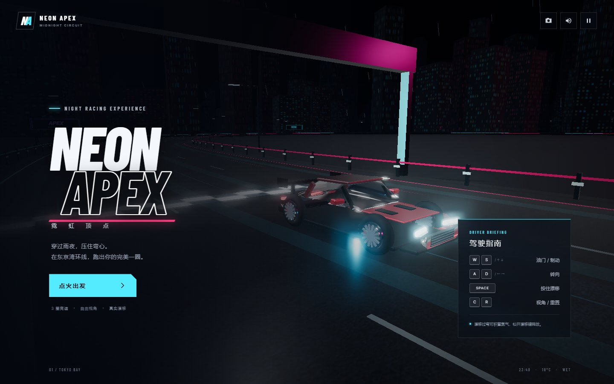

# NEON APEX · 霓虹顶点

一款可直接在浏览器运行的第三人称 3D 竞速游戏。驾驶程序化建模的跑车穿过雨夜东京湾，在霓虹环线中漂移、蓄积氮气并挑战三圈最快圈速。



## 特点

- 三条可切换赛道：东京湾夜环、港湾黄昏、黎明高架，各自拥有独立路线、天空、光照、建筑群与赛道路肩；开始页、暂停页与结算页均可更换赛道
- 高细节建筑群：玻璃幕墙、住宅楼与办公楼使用独立立面纹理；建筑带裙楼、退台塔冠、竖向翼片、阳台、屋顶轮廓灯、霓虹招牌、天线与航空灯；港湾场景额外包含坡屋顶仓库、筒仓、集装箱堆、龙门吊与码头灯
- 4K 级渲染管线：桌面端最高 2× 像素比、4× MSAA、4096 阴影贴图、16× 各向异性过滤、泛光与 ACES 色调映射；移动端自动降低分辨率与阴影规格
- 材质细节：沥青法线/粗糙度贴图、清漆车漆微法线、轮胎花纹法线、湿路面反射、颗粒化霓虹雨夜氛围
- 独特跑车建模：玩家与 7 辆 AI 各自拥有不同车身比例、座舱形式（硬顶/敞篷/敞篷单座/Targa）、灯组、轮毂与空气动力套件，并带有独立号码涂装
- 漂移与氮气：降低后轮抓地力完成甩尾，漂移时快速蓄积氮气；未漂移行驶时氮气也会缓慢回充，按住 `Shift` 持续喷射加速
- AI 对战：桌面端 7 辆 AI 赛车（共 8 车）、移动端 4 辆（共 5 车），具备走线、变线与追赶补偿；高速撞击可将其撞毁出局
- 碰撞惩罚：撞墙或撞车后损失速度并修正车头方向，同时触发火花、撞击音效与镜头震动
- 速度反馈：动态视野、速度线、轮胎烟雾、胎痕、氮气尾焰与排气粒子
- 完整赛事：三圈计时、按赛道分别保存的最佳圈速与总用时、实时名次与分段圈速、实时小地图、逆行提示、暂停与车辆重置
- 多端支持：键盘操作、移动端触屏控制、三种摄像机视角

## 快速开始

运行环境：Node.js 18 或更高版本，支持 WebGL 2 的现代浏览器。

### Windows

双击项目根目录下的 `启动游戏.bat`。脚本会检查环境、在需要时安装依赖、启动本地服务器并自动打开浏览器。游戏结束后关闭命令行窗口即可停止服务器。

### 手动启动

```bash
npm install
npm run dev
```

浏览器访问终端输出的本地地址，默认是 `http://localhost:5173`。

生产构建：

```bash
npm run build
npm run preview
```

## 操作

- `W` / `S` 或 `↑` / `↓`：油门、制动与倒车
- `A` / `D` 或 `←` / `→`：左转、右转
- `Space`：按住漂移，漂移会为氮气蓄能
- `Shift`：按住喷射氮气加速，氮气耗尽后可通过漂移、正常行驶或完成一圈补充
- `C`：切换追尾、引擎盖与远距视角
- `R`：重置车辆，损失部分氮气
- `Esc` / `P`：暂停或继续
- `M`：开启或关闭声音

开始比赛前可在开始页选择三条赛道之一；暂停或冲线后点击“更换赛道”可返回赛道选择页。赛道选择会保存在本地，刷新后自动沿用。

移动端会自动显示方向、油门、制动、漂移与氮气触控按钮。

## 技术实现

游戏使用 Three.js 构建，赛道、车辆、灯光和粒子均由代码生成，不依赖外部 3D 模型或图片素材。渲染管线包含 ACES 色调映射、泛光后处理、PBR 材质、动态点光源与实时雨滴粒子；建筑立面由高分辨率程序化贴图生成，并叠加法线、粗糙度与自发光窗口；道路使用沥青法线/粗糙度映射，跑车使用清漆微法线与轮胎花纹法线。驾驶采用基于航向角、纵向速度和横向抓地力的轻量街机物理模型，氮气系统将漂移侧滑量转化为可主动控制的加速资源；8 辆车由同一套程序化装配管线生成，但各自使用独立的车身截面、座舱结构、灯组、尾翼与轮毂参数，因此外观不会重复；三条赛道分别按主题生成天空穹顶、建筑群与场景道具，切换时会释放旧赛道资源并重建 AI 发车格、小地图和主题光照；AI 对手沿赛道曲线分配走线并带轻微的弯道减速与追赶补偿，玩家高速撞击可将其撞毁。

主要文件：

```text
src/main.js     驾驶物理、赛事状态、摄像机、界面与音效
src/track.js    三套赛道、主题天空/建筑/港湾道具、护栏与看台
src/car.js      8 套独立跑车造型、材质、轮组、灯组与氮气尾焰
src/rivals.js   AI 对手走线、速度控制、碰撞击毁与名次计算
src/effects.js  漂移烟雾、碰撞火花、撞毁爆炸、胎痕与雨滴粒子
src/style.css   游戏界面与响应式布局
index.html      页面结构与 HUD
启动游戏.bat    Windows 一键启动脚本
```

页面字体从 Google Fonts 加载，离线时自动回退到本地无衬线字体，不影响游戏运行。
