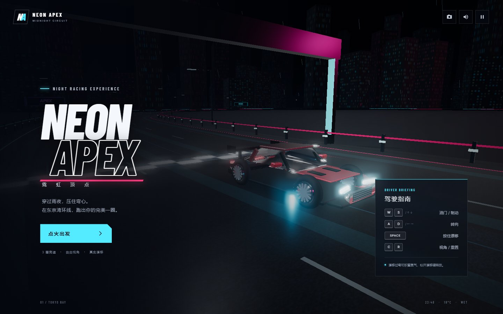

# NEON APEX · 霓虹顶点

一款可直接在浏览器运行的第三人称 3D 竞速游戏。驾驶程序化建模的跑车穿过雨夜东京湾，在霓虹环线中漂移、蓄积氮气并挑战三圈最快圈速。



## 特点

- 霓虹夜景环形赛道：湿润沥青反射、动态路面流光、城市灯海、雨丝与泛光效果
- 真实风格跑车：多层平滑车身曲面、宽体轮拱、双五辐轮毂、刹车卡钳、空气动力学套件、封闭式玻璃座舱与动态灯组
- 漂移与氮气：降低后轮抓地力完成甩尾，漂移时蓄积氮气，按住 `Shift` 持续喷射加速
- 碰撞惩罚：撞墙后损失速度并修正车头方向，同时触发火花、撞击音效与镜头震动
- 速度反馈：动态视野、速度线、轮胎烟雾、胎痕、氮气尾焰与排气粒子
- 完整赛事：三圈计时、最佳圈速、实时小地图、逆行提示、暂停与车辆重置
- 多端支持：键盘操作、移动端触屏控制、三种摄像机视角

## 快速开始

运行环境：Node.js 18 或更高版本，支持 WebGL 2 的现代浏览器。

### Windows

双击项目根目录下的 `启动游戏.bat`。脚本会检查环境、在需要时安装依赖、启动本地服务器并自动打开浏览器。游戏结束后关闭命令行窗口即可停止服务器。

### 手动启动

```bash
npm install
npm run dev
```

浏览器访问终端输出的本地地址，默认是 `http://localhost:5173`。

生产构建：

```bash
npm run build
npm run preview
```

冒烟验证（需先启动开发服务器并安装 Chrome）：

```bash
npm run verify
```

## 操作

- `W` / `S` 或 `↑` / `↓`：油门、制动与倒车
- `A` / `D` 或 `←` / `→`：左转、右转
- `Space`：按住漂移，漂移会为氮气蓄能
- `Shift`：按住喷射氮气加速，氮气耗尽后需通过漂移或完成一圈补充
- `C`：切换追尾、引擎盖与远距视角
- `R`：重置车辆，损失部分氮气
- `Esc` / `P`：暂停或继续
- `M`：开启或关闭声音

移动端会自动显示方向、油门、制动、漂移与氮气触控按钮。

## 技术实现

游戏使用 Three.js 构建，赛道、车辆、灯光和粒子均由代码生成，不依赖外部 3D 模型或图片素材。渲染管线包含 ACES 色调映射、泛光后处理、PBR 材质、动态点光源与实时雨滴粒子；驾驶采用基于航向角、纵向速度和横向抓地力的轻量街机物理模型，氮气系统将漂移侧滑量转化为可主动控制的加速资源。

主要文件：

```text
src/main.js     驾驶物理、赛事状态、摄像机、界面与音效
src/track.js    环形赛道、护栏、城市、霓虹灯牌与环境光
src/car.js      跑车几何、材质、轮组、灯组与氮气尾焰
src/effects.js  漂移烟雾、碰撞火花、胎痕与雨滴粒子
src/style.css   游戏界面与响应式布局
index.html      页面结构与 HUD
启动游戏.bat    Windows 一键启动脚本
```

页面字体从 Google Fonts 加载，离线时自动回退到本地无衬线字体，不影响游戏运行。
